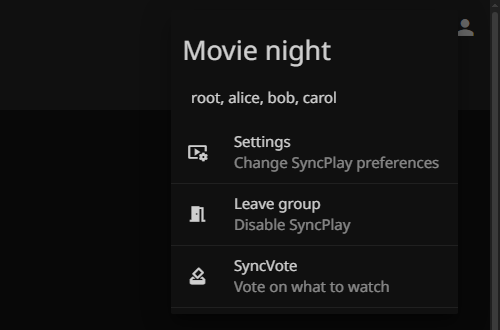
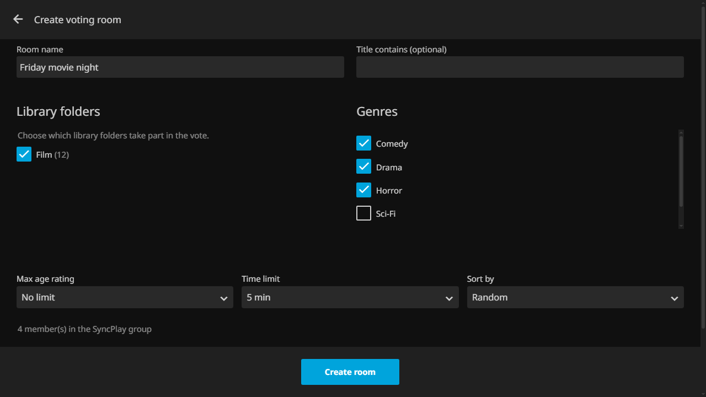
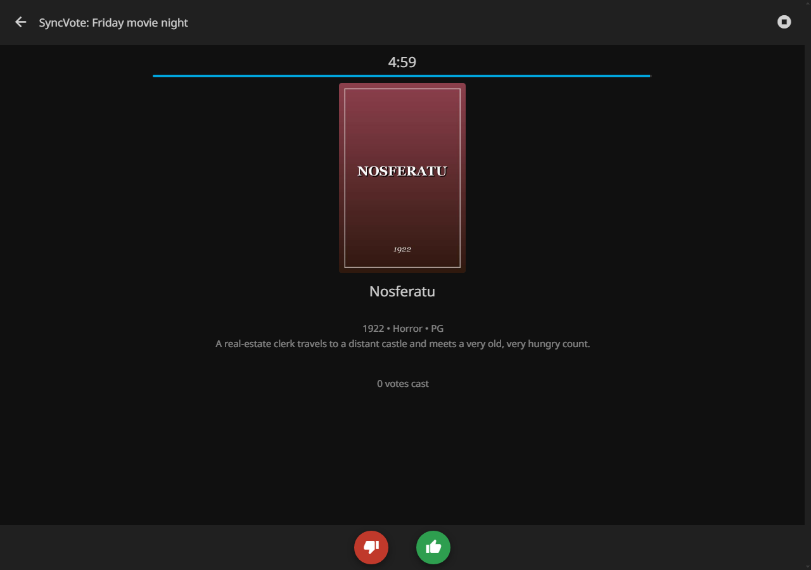
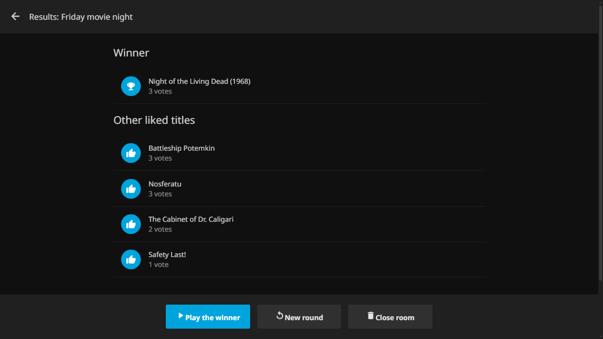

<h1 align="center">SyncVote</h1>

<p align="center">
  <b>Choose what to watch, together.</b><br>
  Swipe-style voting for Jellyfin SyncPlay: everybody likes or dislikes the same titles, the winner starts playing for the whole group.
</p>

<p align="center">
  <a href="LICENSE"></a>
  
  <a href="https://github.com/KappuCitti/jellyfin-plugin-syncvote/releases"></a>
</p>

<p align="center">
  
</p>

Picking a movie for a watch party takes longer than watching it. SyncVote moves the argument into Jellyfin: whoever
organizes opens a voting room from the SyncPlay menu, everybody in the group swipes through the same list of titles for a
few minutes, and the most liked title is queued and played in the SyncPlay group.

It looks and feels like Jellyfin itself (same dialogs, same components) and speaks English and Italian.

## What you get

- **A voting room for your SyncPlay group**, opened from the SyncPlay menu: no extra app, no extra page.
- **Fair voting**: everybody sees the same titles in the same order, and only titles that *every* member is allowed to see.
- **Filters** for the list: library folders, Jellyfin collections, genres, maximum age rating and "title contains". Order it
  randomly, by title, by rating or by premiere date.
- **A time limit** (1 to 120 minutes) enforced by the server. The round ends by itself, the organizer can end it earlier,
  start a new round, or close the room.
- **A runoff** when several titles got a like: one click and everybody votes again, only on those.
- **One click to play** the winner in the SyncPlay group.
- **Access check**: before creating the room the organizer is warned if somebody in the group cannot see the chosen
  libraries (without telling who).
- **Controls for admins**: who can organize or vote, room size, auto-start, room visibility.
- **Like, dislike, or just use the keyboard** (← →) or swipe on touch screens.

## Screenshots

<table>
  <tr>
    <td width="50%"><br><sub><b>1.</b> The organizer picks the libraries, genres and time limit.</sub></td>
    <td width="50%"><br><sub><b>2.</b> Everybody swipes through the same titles.</sub></td>
  </tr>
  <tr>
    <td colspan="2"><br><sub><b>3.</b> The ranking, a button to play the winner in the group, and one to vote again only on the liked titles.</sub></td>
  </tr>
</table>

## Compatibility

Jellyfin plugins cannot be built once for every server version, so SyncVote ships **one package per Jellyfin generation**.
Pick the row of your server:

| Your Jellyfin server | SyncVote package | Status |
|:---|:---|:---|
| **12.x** | `0.1.1.2` | ✅ Supported, tested on 12.2 |
| **10.11.x** | `0.1.1.1` | ✅ Supported, tested on 10.11.11 |
| **10.10.x** | `0.1.1.0` | ✅ Supported, tested on 10.10.7 |
| 10.9.x | – | ⚠️ Not offered by the catalog, not tested |
| 10.8.x and older | – | ❌ Not supported (needs a Jellyfin feature that appeared in 10.9) |

The last digit of the version is the Jellyfin generation (`.0` → 10.10, `.1` → 10.11, `.2` → 12), and the first three are the
release (`0.1.1` above). So **`0.1.1.0` is the build for Jellyfin 10.10 only**, not for newer servers.

> [!NOTE]
> You do not have to choose: add the repository (see below) and Jellyfin offers the package made for your server.

> [!WARNING]
> Packages are not interchangeable. If you install by hand, take the one for your server: a 10.10 package on Jellyfin 10.11
> or 12 loads but most features fail with errors, and a package for a newer generation does not load at all on an older server.

SyncVote works in the **Jellyfin web client** (browsers and apps built on it), in the new interface of Jellyfin 12 as well as
in the classic one. Native apps (Android, iOS, TV…) do not show the SyncVote entry yet.

## Installation

1. In Jellyfin, open **Dashboard → Plugins → Repositories → Add** and paste:

   ```text
   https://raw.githubusercontent.com/KappuCitti/jellyfin-plugin-syncvote/master/manifest.json
   ```

2. Open **Catalog**, install **SyncVote**, and restart the server.

That is all: the plugin adds its own script to the web client, no other plugin is needed. Reload the web page once
(`Ctrl+F5`) after the first start.

## Using SyncVote

1. Everybody joins the same **SyncPlay group** (the SyncPlay button in the top bar).
2. Open the SyncPlay menu and pick **SyncVote**.
3. The organizer creates the room: a name, at least one library folder or collection, and optionally genres, an age rating,
   a title filter, the time limit and the order.
4. The others open the same menu entry and join. When everybody is in, the organizer starts the voting.
5. Like or dislike each title. The time left is shown on top.
6. When the time is up (or the organizer stops it with the stop icon in the header) the results appear. The organizer can
   **play the winner**, start a **runoff**, start a **new round**, or **close** the room.

A **runoff** is a new round with only the titles that got at least one like, so the group can settle a close call. It is
offered when two or more titles were liked, and the ranking of the runoff starts from zero. A **new round** goes back to the
whole list.

> [!TIP]
> Turn on **Auto-start voting** in the plugin settings and the round starts as soon as every member of the SyncPlay group has
> joined the room.

## Settings

Dashboard → Plugins → SyncVote.

| Option | What it does |
|:---|:---|
| Default time limit / default sort order | Starting values of the create form |
| Max room members | How many people can join a room |
| Language | `Same as the server` (default), English or Italiano |
| Show every room to everyone | When off, people only see rooms they are in or the one of their SyncPlay group |
| Auto-start voting | Start when every SyncPlay member has joined the room |
| Users can organize / can vote | Defaults for everybody; administrators can always do both |
| Add SyncVote to the web interface | Turn off only if another plugin loads the script for you |

<details>
<summary>Allow or forbid single users</summary>

The exceptions per user are not in the settings page yet. Stop the server, add them to
`plugins/configurations/KappuCitti.Plugin.SyncVote.xml` in the Jellyfin data folder, and start it again:

```xml
<UserPermissionOverrides>
  <UserPermissions>
    <UserId>3546ba77-ea1c-4d51-b4b1-c462ce9c1830</UserId>
    <CanOrganize>false</CanOrganize>
    <CanVote>true</CanVote>
  </UserPermissions>
</UserPermissionOverrides>
```

The user ids are in the address of the user's page in the dashboard.

</details>

## Good to know

> [!NOTE]
> Rooms and votes live in the server's memory only, nothing is written to disk. A room lasts at most a day and goes away when
> the server restarts, which is fine for a movie night.

> [!NOTE]
> The language of the SyncVote screens is the display language of the **server** (Dashboard → General), so everybody in the
> group reads the same thing, even if their browsers differ. Change it in the plugin settings if you want another one.

> [!IMPORTANT]
> The voting list only contains titles that **every member** of the room can see (library access and parental controls
> included). If a title you expect is missing, somebody in the room is not allowed to see it.

## Troubleshooting

<details>
<summary>I do not see the SyncVote entry</summary>

- The entry is in the SyncPlay menu **of a group**: join or create a SyncPlay group first. In the new interface it is the first
  item of the menu, above *Settings*.
- Reload the page with `Ctrl+F5` after installing or updating.
- Make sure *Add SyncVote to the web interface* is on (Dashboard → Plugins → SyncVote).
- Open `https://your-server/SyncVote/Client/syncvote.js` in the browser: it should show JavaScript. If not, the plugin is not
  running: check Dashboard → Plugins and the server log.
- Native apps (Android, iOS, TV) do not show it: use the web client.
</details>

<details>
<summary>The plugin does not start after an update of Jellyfin</summary>

A new Jellyfin generation needs the SyncVote package made for it. Open the catalog and update the plugin; if the new package is
not out yet, SyncVote stays unavailable until it is.
</details>

<details>
<summary>The screens are in the wrong language</summary>

They follow the display language of the server. Change it in Dashboard → General, or pick a language in the plugin settings.
</details>

<details>
<summary>There is no "Collections" list in the create form</summary>

It only appears when your server has Jellyfin collections (box sets). Create one in Jellyfin and it shows up.
</details>

## Documentation

- [API reference](docs/API.md): the endpoints of the plugin.
- [Development guide](docs/DEVELOPMENT.md): build, test, how the Jellyfin versions are supported.
- [Contributing](CONTRIBUTING.md) and the [open issues](https://github.com/KappuCitti/jellyfin-plugin-syncvote/issues) (what is planned).
- [End-to-end tests](tests/e2e/README.md).

## License

[GNU General Public License v3.0](LICENSE).
